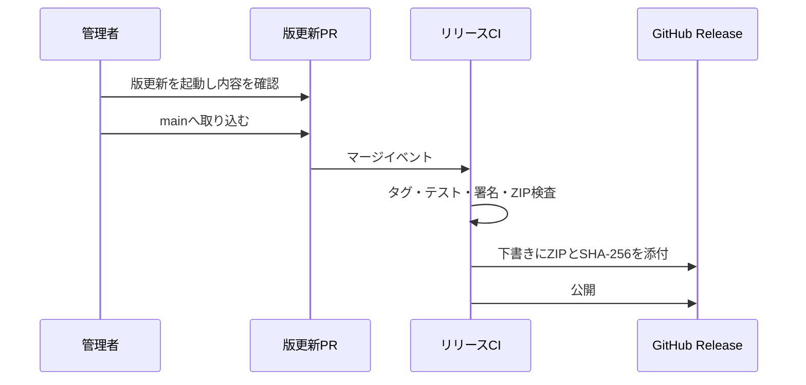

# Chizuのリリースの設計

[English](design.md)

## このドキュメントについて

[リリースの要件](requirements.ja.md)と[Chizuの目的](../../product.ja.md)に従い、版更新から配布物の公開までの処理を定めます。

### 対象読者

Chizuの実装・リリースを行う人とエージェントです。

### 前提知識

macOSのアプリ署名とGitHub Actionsの基本的な操作です。

### このドキュメントで扱わないこと

個人用の振り分け条件と、アプリ内更新の実装です。

## 実装方針

版の正本を`VERSION`に置きます。手動起動するワークフローが版を上げたPRを作り、そのPRがmainへ取り込まれると、対応するタグを作成してリリースを開始します。初回リリースでは、管理者がmainの対応するタグを直接pushできます。既存タグを指定して再実行する経路も用意します。タグ、`VERSION`、アプリ内の版を同じ値にします。

配布用アプリはApple SiliconのmacOS上で作ります。固定した証明書の公開指紋をリポジトリに置き、秘密鍵とパスワードをCIのSecretsから渡します。証明書の指紋が異なると署名せずに失敗します。署名済みアプリをZIPにし、展開後にも署名と版を検査してからSHA-256を計算します。[GitHubのランナー一覧](https://docs.github.com/en/actions/how-tos/write-workflows/choose-where-workflows-run/choose-the-runner-for-a-job)で`macos-26`がApple Siliconと確認できます。

リリースは下書きを作り、ZIPとチェックサムのアップロードが成功してから公開します。版更新PRの本文を公開文に使い、タグから再実行した場合も対応するPRを探します。[GitHubのワークフロー起動仕様](https://docs.github.com/en/actions/how-tos/write-workflows/choose-when-workflows-run/trigger-a-workflow)では、`GITHUB_TOKEN`で発生した通常のイベントは別ワークフローを起動しないため、PRが人によってマージされたイベントをリリースの主経路にします。

## アーキテクチャ・シーケンス図

版の更新と配布の責務が分かれるため、処理を図示します。

## データモデル・ER 図

`VERSION`は`MAJOR.MINOR.PATCH`です。タグは先頭に`v`を付けます。公開する`config/release-signing.json`は証明書のSHA-256だけを持ちます。秘密鍵、PKCS#12、パスワードはGit管理外の`.release-signing/`とCI Secretsに置きます。単純な一対一の関係なのでER図は不要です。

## API・インターフェース

管理者はGitHub Actionsの「Create Release PR」を起動し、`patch`、`minor`、`major`を選びます。PRのマージでリリースが始まります。初回は対応するタグをpushして「Release」を直接起動できます。失敗時は既存タグを指定した「Release」の手動再実行を使えます。

ローカルでは`bash scripts/version.sh`で版を確認し、`bash scripts/package-release.sh`で同じ署名のZIPを作ります。証明書の初回準備には`bash scripts/setup-release-signing.sh`を使います。ローカルの署名検証には`bash scripts/trust-release-certificate.sh`で証明書をコード署名用途だけに信頼登録します。

## 外部サービスとの連携方式

GitHub Actionsは版更新PRとリリースの二つのワークフローを実行します。PRの作成、タグの作成、リリースの公開を行うジョブにだけ、必要な書き込み権限を与えます。署名情報は`CODE_SIGN_P12_BASE64`と`CODE_SIGN_P12_PASSWORD`をSecretsから読み、出力やログに書きません。

## データの取り扱い設計

公開証明書の指紋はGitで履歴を残します。秘密情報はローカルではGit無視のディレクトリに保存し、CIでは一時的なキーチェーンへ読み込みます。CIの終了時に一時ファイルと信頼設定を削除します。配布物には個人設定を含めません。

## 認証認可に関する特記事項

GitHubのトークン権限はジョブごとに最小限を指定します。署名の秘密情報はリリースを作るジョブでだけ使います。

## セキュリティ上の留意事項

証明書の指紋、署名済みアプリの固定した識別要件、展開したZIPの署名を確認します。公開済みリリースを再実行で自動上書きしません。

## デプロイに関する特記事項

初回リリース前に署名の秘密情報をGitHub Secretsへ登録します。すでに別の署名で使っているChizuから配布版へ切り替える場合、macOSのAutomation許可は署名の変更により再確認が必要になる可能性があります。

## 検討した代替手段

### 版ごとに署名を作る

新しい証明書を毎回作ると、同じアプリの更新としてmacOSが扱うための署名識別が変わります。固定した証明書を使います。

## 未決事項

なし。
