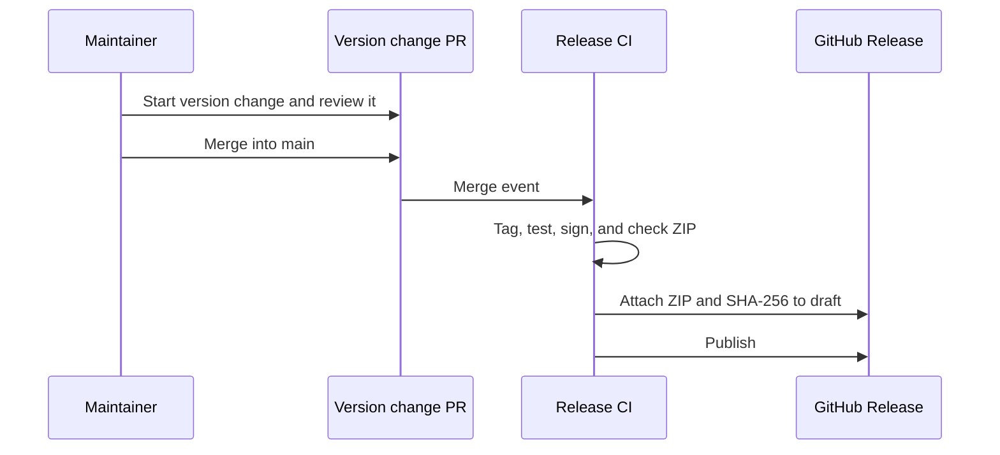

# Chizu release design

[日本語](design.ja.md)

## About this document

This design defines the process from a version change to artifact publication under the [release requirements](requirements.md) and [Chizu product purpose](../../product.md).

### Audience

People and agents who implement or release Chizu.

### Prerequisites

Basic familiarity with macOS app signing and GitHub Actions.

### Not covered here

Personal routing rules and implementation of in-app updates.

## Implementation approach

`VERSION` is the source of the release version. A manually started workflow opens a PR that bumps it. When that PR merges into `main`, the release workflow creates the matching tag and starts the release. An existing tag can also be selected for a retry. The tag, `VERSION`, and app bundle version use the same value.

The distribution app is built on Apple Silicon macOS. The repository contains the fixed certificate's public fingerprint, while CI Secrets provide its private key and password. A fingerprint mismatch fails before signing. The signed app is zipped; after extraction, the signature and version are checked again before calculating SHA-256. The [GitHub runner list](https://docs.github.com/en/actions/how-tos/write-workflows/choose-where-workflows-run/choose-the-runner-for-a-job) identifies `macos-26` as an Apple Silicon runner.

The workflow creates a draft release and publishes it only after the ZIP and checksum upload succeeds. The version change PR body becomes the release notes; a retry from a tag looks up the corresponding PR. According to [GitHub's workflow triggering rules](https://docs.github.com/en/actions/how-tos/write-workflows/choose-when-workflows-run/trigger-a-workflow), ordinary events caused by `GITHUB_TOKEN` do not start another workflow, so a human merging the PR is the primary release trigger.

## Architecture and sequence diagram

The diagram separates the version change from artifact publication.

## Data model and ER diagram

`VERSION` uses `MAJOR.MINOR.PATCH`; a tag prefixes it with `v`. The public `config/release-signing.json` contains only the certificate's SHA-256. The private key, PKCS#12 file, and password stay in Git ignored `.release-signing/` and CI Secrets. These have a simple one-to-one relationship, so an ER diagram is unnecessary.

## APIs and interfaces

The maintainer starts **Create Release PR** in GitHub Actions and chooses `patch`, `minor`, or `major`. Merging the PR starts the release. After a failure, the maintainer can manually rerun **Release** with an existing tag.

Locally, `bash scripts/version.sh` reads the version and `bash scripts/package-release.sh` builds a ZIP with the same signing identity. `bash scripts/setup-release-signing.sh` creates the initial certificate. To verify signing locally, `bash scripts/trust-release-certificate.sh` trusts that certificate for code signing only.

## External service integration

GitHub Actions runs separate workflows for the version change PR and the release. Only jobs that create the PR or tag, or publish the release, receive the write permissions they need. The build reads `CODE_SIGN_P12_BASE64` and `CODE_SIGN_P12_PASSWORD` from Secrets without printing them to output or logs.

## Data handling

The public certificate fingerprint is kept in Git history. Private information is stored locally in an ignored directory and in a temporary CI keychain. Temporary files and trust settings are removed after CI completes. Artifacts contain no personal configuration.

## Authentication and authorization

GitHub token permissions are limited by job. Only the job that builds the release uses private signing information.

## Security considerations

Check the certificate fingerprint, the signed app's fixed identity requirement, and the signature of the extracted ZIP. A retry does not automatically overwrite an already published release.

## Deployment notes

Before the first release, add private signing information to GitHub Secrets. When switching an existing Chizu install signed with another certificate to the distribution build, macOS may require granting Dia Automation permission again because the signature changed.

## Alternatives considered

### Create a new signing certificate for every version

Doing so changes the signing identity macOS uses to recognize the same app across updates. Chizu keeps a fixed certificate instead.

## Open questions

None.
