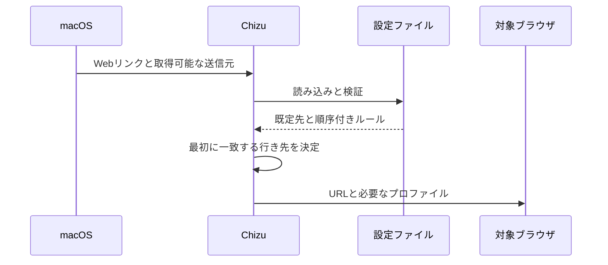

# リンクの振り分けの設計

[English](design.md)

## このドキュメントについて

[リンクの振り分け要件](requirements.ja.md)と[Chizuの目的](../../product.ja.md)を、macOSのアプリとファイル設定で実現します。

### 対象読者

Chizuの実装・変更を行う人とエージェントです。

### 前提知識

macOSのURLハンドラと、ブラウザのアプリ識別子です。

### このドキュメントで扱わないこと

個人用ルールの内容と、ブラウザがどのリンクをChizuへ渡すかの判定です。

## 実装方針

ChizuはHTTPとHTTPSを受け取るmacOSアプリです。リンクを受け取るたびに通常の設定ファイルを読み直し、純粋なルール評価処理で行き先を決め、対象のブラウザを明示して開きます。アプリ本体を既定先として再度呼び出さないよう、対象アプリを指定します。

正規表現の条件にはmacOSの`NSRegularExpression`を使います。[Appleの資料](https://developer.apple.com/documentation/foundation/nsregularexpression)によればICU形式に従い、[ChoosyのURL条件](https://choosy.app/help/settings/rules/urls)も同じ形式です。式をURL全体に固定して照合し、一部への一致だけではルールを適用しません。大文字・小文字は通常区別し、式内の`(?i)`で無視できます。設定の読み込み時に式を検査し、無効ならルール名とともにエラーを返します。条件の追加だけで足りるため、式言語の実行環境は導入しません。

Diaのプロファイル指定には、Dia自身が公開しているAppleScriptの`profile`と`tab`を使います。名前を指定したプロファイルにタブを作成し、その識別子でタブを取得し直して`focus`で選択した後、`activate`でDiaを前面に出します。タブを作るだけでは既存のタブが表示され続けるため、選択中のタブが新しいタブかも確認します。個人用のプロファイル名は本体に含めません。Diaを操作する際にはmacOSのオートメーション許可が必要です。

Chromeのプロファイル指定には、Chromeの`Local State`にある表示名とプロファイルディレクトリの対応を使います。表示名が一つだけ一致し、そのディレクトリが存在するときに、Chromeの実行ファイルへ`--profile-directory`とURLを別々の引数として渡します。[Chromiumの起動オプション](https://chromium.googlesource.com/chromium/src/+/lkgr/chrome/common/chrome_switches.h)はこの値をプロファイルのディレクトリとして扱います。表示名が見つからない、重複する、保存情報を読めない、またはディレクトリがない場合はリンクを開きません。Chromeが起動済みのときも引数を渡せるよう、URLの通常起動とは別にChromeの実行ファイルを呼びます。公開する本体に個人のプロファイル名は含めません。

ブラウザのユーザースクリプトや拡張機能からリンクを渡せるよう、`chizu-http`と`chizu-https`のURLスキームも登録します。ブラウザはHTTPやHTTPSのリンクを既定ブラウザへ渡せませんが、他のアプリが登録したスキームのURLは開けます。受け取ったら、大文字と小文字を区別せずに先頭の`chizu-`を1回だけ取り除き、そのHTTPまたはHTTPSのリンクを受け取った場合と同じく振り分けます。取り除いた結果もHTTPかHTTPSでなければならないため、`chizu-file:`や`chizu-chizu-https:`のように接頭辞を重ねたものは失敗します。どのリンクを渡すかはブラウザ側で決め、Chizuは受け取ったものを振り分けるだけです。渡されたリンクの行き先が送り元のブラウザであっても、Chizuはそのブラウザで開きます。そのため、ブラウザ側のルールでは、設定上同じブラウザへ戻るリンクを渡さないようにします。

リンク元アプリは受信したApple Eventの送信元プロセスから識別できた場合だけ条件に使います。送信元を得られない場合にもURL条件と既定先は機能します。[HammerspoonのURL受信実装](https://github.com/Hammerspoon/hammerspoon/blob/master/extensions/urlevent/liburlevent.m)もApple Eventの送信元プロセスを使っています。

## アーキテクチャ・シーケンス図

受信、評価、起動の順序を示すため、次の図を使います。

## データモデル・ER 図

JSONC設定の`version`、`default`、`rules`を読み取ります。`//`と`/* ... */`のコメント、および末尾のカンマを受け付けます。文字列内の記号はそのまま残し、コメントと末尾のカンマだけを取り除いてからJSONとして検証します。各`rule`は`name`、`when`、`destination`を持ちます。`when`はURL全体の包含・正規表現、ホストの完全一致、パスの前方一致、リンク元アプリ識別子を組み合わせられます。`destination`はアプリ識別子と省略可能なDiaまたはChromeのプロファイル表示名を持ちます。関係は単純な順序付きの入れ子構造なのでER図は不要です。

## API・インターフェース

通常の設定場所は`~/.config/chizu/config.jsonc`です。シンボリックリンクにも対応し、Git管理しているファイルをそのまま参照できます。`config init`は、Safariを既定の行き先とする空のルールを含む最小限のJSONCファイルを本体の内容から作り、ネットワーク通信を必要としません。親ディレクトリを作り、所有者だけが読める権限で設定ファイルを新規作成専用で開くため、既存のファイルやシンボリックリンクは置き換えません。`--config FILE`で初期設定の作成、検査、確認に使う別のファイルを指定できます。

`check URL`と`open URL`も`chizu-http`と`chizu-https`のリンクを受け付け、アプリと同じく接頭辞を取り除きます。`config check`で設定を検査し、`check URL`で起動せずに結果を確認します。`check`にはURLが必要です。`--source`はCLIでの確認や手動起動に使うリンク元アプリ識別子です。`default status`はmacOSのHTTPとHTTPSの行き先を読み取り、`default set`は両方をChizuへ変更します。JSONCの`default`は一致するルールがないときの行き先であり、macOSの設定とは別です。CLIは`--help`に示したコマンド形式だけを受け付け、以前の名前を別名として残しません。`--help`には各コマンドの書式と用途、JSONCの項目と照合順序、コピーして使える例を表示し、設定ファイルは読みません。READMEには汎用のJSONC設定例を載せ、`check URL`の出力を説明します。アプリはリンク受信時に同じ評価処理を使います。

ブラウザはアプリ識別子で指定します。プロファイルを指定しない場合はmacOSの`open`コマンドに対象アプリを明示してURLを渡します。Diaのプロファイル指定は、固定のAppleScriptにプロファイル名とURLを引数として渡します。Chromeのプロファイル指定は表示名を保存情報と照合してから、選んだディレクトリを起動引数として渡します。URLや名前をシェルの文字列として解釈しません。

## 外部サービスとの連携方式

ネットワークサービスは不要です。DiaのAppleScript定義とChromeのプロファイル保存情報は利用者のMacから読みます。アプリが未インストール、必要な許可がない、プロファイルを特定できない場合は失敗を返します。

## データの取り扱い設計

設定ファイルはリンクを開くたびに読み、プロセス内でのみ使います。受信URLと送信元アプリは振り分けに使い、履歴として保存しません。公開するリポジトリには汎用の設定例だけを置きます。

## 認証認可に関する特記事項

アカウント認証はありません。Diaの操作には利用者がmacOSのオートメーション許可を与えます。Chizuはその許可を迂回しません。

## セキュリティ上の留意事項

渡されたリンクから`chizu-`を取り除いたうえで、HTTPとHTTPS以外を受け付けず、設定ファイルの必須項目と行き先を検証します。外部コマンドへ渡すURL・プロファイル名は別々の引数とし、シェルとして解釈しません。

## デプロイに関する特記事項

アプリをインストールしたあと、macOSの既定ブラウザに登録する必要があります。既存の既定ブラウザ設定は切替を実行するまで保持します。

## 検討した代替手段

### キーボードショートカットによるDiaの切替

既存の[Dia Router](https://github.com/jdsimcoe/dia-router)はプロファイル切替のショートカットを送ってからURLを開きます。ショートカット設定とアクセシビリティ許可、切替の待ち時間に依存するため、Diaが公開するAppleScript操作を選びます。

### URLをクエリパラメーターで渡す

`chizu://open?url=...`のような形では、URL全体をパーセントエンコードする必要があります。Chromeの[`declarativeNetRequest`](https://developer.chrome.com/docs/extensions/reference/api/declarativeNetRequest)は正規表現の置換でしかリダイレクト先を組み立てられず、取り出したURLをエンコードできません。元のリンクにエンコードされていない`&`や`#`があるとパラメーターが崩れます。スキームだけを置き換える形ならエンコードは不要で、接頭辞の後ろに元のURLがそのまま読めます。

## 未決事項

なし。
