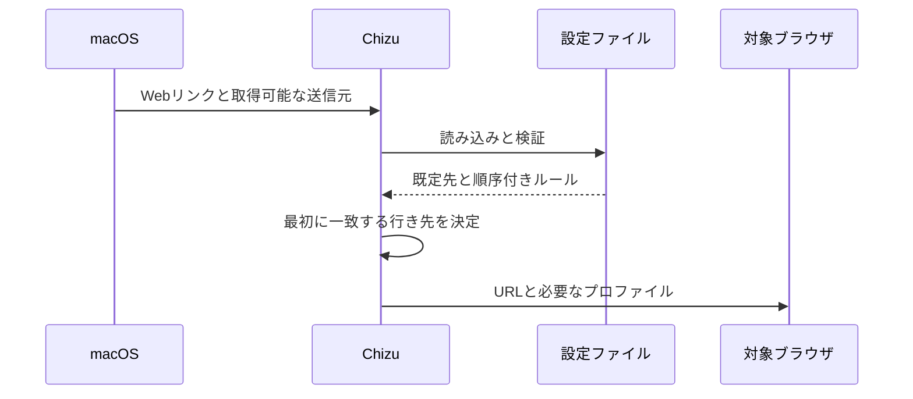

# リンクの振り分けの設計

## このドキュメントについて

[リンクの振り分け要件](requirements.md)と[Chizuの目的](../../product.md)を、macOSのアプリとファイル設定で実現します。

### 対象読者

Chizuの実装・変更を行う人とエージェントです。

### 前提知識

macOSのURLハンドラと、ブラウザのアプリ識別子です。

### このドキュメントで扱わないこと

個人用ルールの内容と、ブラウザ内で開くリンクの取り扱いです。

## 実装方針

ChizuはHTTPとHTTPSを受け取るmacOSアプリです。リンクを受け取るたびに通常の設定ファイルを読み直し、純粋なルール評価処理で行き先を決め、対象のブラウザを明示して開きます。アプリ本体を既定先として再度呼び出さないよう、対象アプリを指定します。

正規表現の条件にはmacOSの`NSRegularExpression`を使います。[Appleの資料](https://developer.apple.com/documentation/foundation/nsregularexpression)によればICU形式に従い、[ChoosyのURL条件](https://choosy.app/help/settings/rules/urls)も同じ形式です。式をURL全体に固定して照合し、一部への一致だけではルールを適用しません。大文字・小文字は通常区別し、式内の`(?i)`で無視できます。設定の読み込み時に式を検査し、無効ならルール名とともにエラーを返します。条件の追加だけで足りるため、式言語の実行環境は導入しません。

Diaのプロファイル指定には、Dia自身が公開しているAppleScriptの`profile`と`tab`を使います。名前を指定したプロファイルにタブを作成し、その識別子でタブを取得し直して`focus`で選択した後、`activate`でDiaを前面に出します。タブを作るだけでは既存のタブが表示され続けるため、選択中のタブが新しいタブかも確認します。個人用のプロファイル名は本体に含めません。Diaを操作する際にはmacOSのオートメーション許可が必要です。

リンク元アプリは受信したApple Eventの送信元プロセスから識別できた場合だけ条件に使います。送信元を得られない場合にもURL条件と既定先は機能します。[HammerspoonのURL受信実装](https://github.com/Hammerspoon/hammerspoon/blob/master/extensions/urlevent/liburlevent.m)もApple Eventの送信元プロセスを使っています。

## アーキテクチャ・シーケンス図

受信、評価、起動の順序を示すため、次の図を使います。

## データモデル・ER 図

JSONC設定の`version`、`default`、`rules`を読み取ります。`//`と`/* ... */`のコメント、および末尾のカンマを受け付けます。文字列内の記号はそのまま残し、コメントと末尾のカンマだけを取り除いてからJSONとして検証します。各`rule`は`name`、`when`、`destination`を持ちます。`when`はURL全体の包含・正規表現、ホストの完全一致、パスの前方一致、リンク元アプリ識別子を組み合わせられます。`destination`はアプリ識別子と省略可能なDiaプロファイル名を持ちます。関係は単純な順序付きの入れ子構造なのでER図は不要です。

## API・インターフェース

通常の設定場所は`~/.config/chizu/config.jsonc`です。シンボリックリンクにも対応し、Git管理しているファイルをそのまま参照できます。コマンドラインでは`--config`で別のファイルを指定し、`validate`で設定を検査し、`decide URL`で起動せずに結果を確認します。アプリはリンク受信時に同じ評価処理を使います。

ブラウザはアプリ識別子で指定します。Dia以外のブラウザはmacOSの`open`コマンドに対象アプリを明示してURLを渡します。Diaのプロファイル指定は、固定のAppleScriptにプロファイル名とURLを引数として渡します。設定値をスクリプトのソース文字列へ埋め込まないため、引用符などを含むURLも命令に変わりません。

## 外部サービスとの連携方式

ネットワークサービスは不要です。DiaのAppleScript定義はインストール済みアプリに含まれています。Diaが未インストール、スクリプト実行の許可がない、プロファイルが見つからない場合は失敗を返します。

## データの取り扱い設計

設定ファイルはリンクを開くたびに読み、プロセス内でのみ使います。受信URLと送信元アプリは振り分けに使い、履歴として保存しません。公開するリポジトリには汎用の設定例だけを置きます。

## 認証認可に関する特記事項

アカウント認証はありません。Diaの操作には利用者がmacOSのオートメーション許可を与えます。Chizuはその許可を迂回しません。

## セキュリティ上の留意事項

HTTPとHTTPS以外を受け付けず、設定ファイルの必須項目と行き先を検証します。外部コマンドへ渡すURL・プロファイル名は別々の引数とし、シェルとして解釈しません。

## デプロイに関する特記事項

アプリをインストールしたあと、macOSの既定ブラウザに登録する必要があります。既存の既定ブラウザ設定は切替を実行するまで保持します。

## 検討した代替手段

### キーボードショートカットによるDiaの切替

既存の[Dia Router](https://github.com/jdsimcoe/dia-router)はプロファイル切替のショートカットを送ってからURLを開きます。ショートカット設定とアクセシビリティ許可、切替の待ち時間に依存するため、Diaが公開するAppleScript操作を選びます。

## 未決事項

なし。
