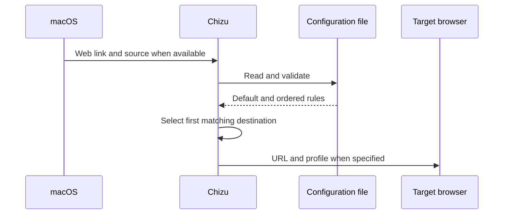

# Link routing design

[日本語](design.ja.md)

## About this document

This design implements the [link routing requirements](requirements.md) and the [Chizu product purpose](../../product.md) with a macOS app and file based configuration.

### Audience

People and agents who implement or change Chizu.

### Prerequisites

macOS URL handlers and browser bundle identifiers.

### Not covered here

The content of personal rules and links opened directly inside a browser.

## Implementation approach

Chizu is a macOS app that receives HTTP and HTTPS links. It reads the regular configuration file for each link, selects a destination with a rule evaluator, and explicitly opens the target browser. Specifying that app prevents Chizu, as the default browser, from invoking itself again.

The regular expression condition uses macOS `NSRegularExpression`. [Apple's documentation](https://developer.apple.com/documentation/foundation/nsregularexpression) describes its ICU syntax, which [Choosy's URL rules](https://choosy.app/help/settings/rules/urls) also use. Chizu anchors the expression to the full URL, so a partial match does not apply. Matching is case sensitive by default, and `(?i)` in the expression can ignore case. Chizu checks expressions while loading configuration and reports invalid ones with their rule names. Adding this condition avoids introducing an expression language runtime.

Dia profile routing uses the `profile` and `tab` objects exposed by Dia's AppleScript interface. Chizu creates a tab in the named profile, retrieves it again by ID, calls `focus` to select it, and then calls `activate` to bring Dia forward. Creating the tab alone could leave the previous tab visible, so Chizu also checks that the newly created tab is active. Personal profile names stay out of the public app. macOS Automation permission is required to control Dia.

Chrome profile routing reads the association between visible names and profile directories from Chrome's `Local State`. If exactly one name matches and its directory exists, Chizu passes that directory with `--profile-directory` and the URL as separate arguments to Chrome's executable. [Chromium's command line switch](https://chromium.googlesource.com/chromium/src/+/lkgr/chrome/common/chrome_switches.h) treats the value as a profile directory. Chizu does not open the link if the name is missing or duplicated, the state cannot be read, or the directory is missing. It invokes Chrome's executable separately from ordinary URL opening so the argument also reaches an already running Chrome instance. The public app contains no personal profile names.

Chizu uses the sending process of the received Apple Event as a source app condition when that process can be identified. URL conditions and the default destination still work when it cannot. [Hammerspoon's URL event implementation](https://github.com/Hammerspoon/hammerspoon/blob/master/extensions/urlevent/liburlevent.m) also reads the sending process from Apple Events.

## Architecture and sequence diagram

The diagram shows the order of receiving, evaluating, and opening a link.

## Data model and ER diagram

Chizu reads `version`, `default`, and `rules` from JSONC. It accepts `//` and `/* ... */` comments and trailing commas. It removes only comments and trailing commas, preserving characters inside strings, before validating the result as JSON. Each `rule` contains `name`, `when`, and `destination`. A `when` object may combine full URL containment or a regular expression, exact host matching, path prefix matching, and a source app identifier. A `destination` contains a bundle identifier and an optional visible Dia or Chrome profile name. The data is a simple ordered nested structure, so an ER diagram is unnecessary.

## APIs and interfaces

The usual configuration path is `~/.config/chizu/config.jsonc`. It may be a symbolic link to a Git managed file. The CLI accepts `--config` to select another file, `check` to check configuration, and `decide URL` to preview a result without opening the link. `--source` supplies a source app identifier for a CLI preview or manual open. The `--help` output lists each command's form and purpose, the JSONC keys and matching order, and copyable examples. It does not read the configuration file. The README includes a complete generic JSONC example and explains the `decide` output. The app uses the same evaluator when receiving links.

Browsers are selected by bundle identifier. Without a profile, Chizu passes the URL to macOS `open` with the target app specified. For Dia, it passes the profile name and URL as arguments to a fixed AppleScript. For Chrome, it resolves the visible name from saved profile information and passes the selected directory as a launch argument. URLs and names are not interpreted as shell text.

## External service integration

No network service is required. Dia's AppleScript interface and Chrome's saved profile information are read from the user's Mac. A missing app, missing required permission, or profile that cannot be identified causes an error.

## Data handling

Chizu reads the configuration file for each link and keeps it only in the process. It uses the received URL and source app for routing without storing a history. Only a generic configuration example belongs in the public repository.

## Authentication and authorization

There is no account authentication. The user grants macOS Automation permission for Dia control; Chizu does not bypass it.

## Security considerations

Chizu accepts only HTTP and HTTPS URLs and validates required configuration fields and destinations. It passes URLs and profile names as separate process arguments, not shell commands.

## Deployment notes

After installing Chizu, the user sets it as the macOS default browser. The existing default browser remains until that change is made.

## Alternatives considered

### Switching Dia profiles with a keyboard shortcut

[Dia Router](https://github.com/jdsimcoe/dia-router) switches profiles with keyboard shortcuts before opening a URL. That depends on shortcut settings, Accessibility permission, and the timing of the switch. Chizu uses Dia's AppleScript interface instead.

## Open questions

None.
